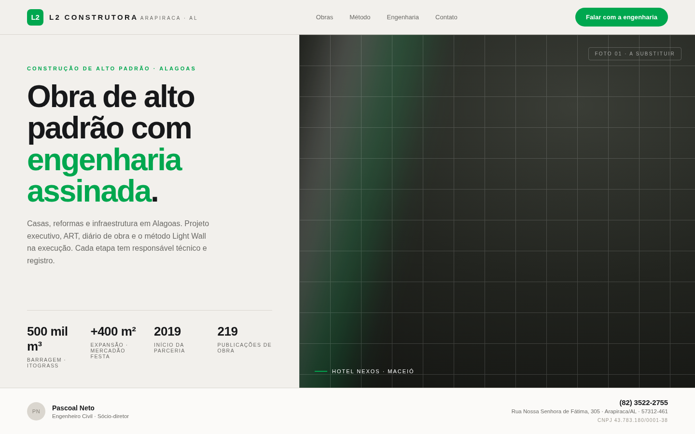

# Plano — site da L2 Construtora

> **Fonte única:** os perfis `@l2construtora` e `@pascoalneto` no Instagram.
> Nada aqui foi inventado; o que não tem lastro no perfil está marcado `[confirmar]`.

---

## 1. O que a varredura entregou (fatos com origem)

| Campo | Dado | Origem |
|---|---|---|
| Razão social | **L2 CONSTRUTORA LTDA** — CNPJ **43.783.180/0001-38**, ATIVA desde **06/10/2021**, CNAE 41.20-4-00 (Construção de edifícios) | Receita Federal (BrasilAPI) |
| Telefone | **(82) 3522-2755** | Receita Federal + diretório LojasDeConstrucao |
| Endereço | **Rua Nossa Senhora de Fátima, 305 — Alto do Cruzeiro — Arapiraca/AL — 57312-461** | Receita Federal |
| Sócia-administradora | **Amanda Silva Araujo Barboza** | QSA / Receita Federal |
| Nome / @ | L2 Construtora — @l2construtora | Instagram |
| Bio | "Construtora em Alagoas · Obras, reformas e planejamento personalizados · Qualidade + compromisso em cada projeto · Fale conosco no WhatsApp" | Instagram |
| Porte | 3.083 seguidores · 219 publicações | Instagram |
| Praça | Alagoas — sede em **Arapiraca**, obras em **Maceió** e região | Receita + legendas |
| Sócio-diretor | **Pascoal Neto — Engenheiro Civil, Sócio-Diretor da @l2construtora** | bio de @pascoalneto |
| Cor da marca | **verde `#00A74F` sobre branco/cinza** | pixel dominante do avatar |
| Obra 1 | Casa no **Condomínio Perucaba** — arquitetura, acabamento, "cada detalhe" | legenda |
| Obra 2 | **Barragem para a Itograss** — represamento de **mais de 500 mil m³** | legenda |
| Obra 3 | **Mercadão Festa** — reforma (2019) e **expansão com mais de 400 m²** | legenda |
| Obra 4 | **Hotel Nexos Maceió** — método construtivo **Light Wall** | legenda |
| Obra 5 | Residência de alto padrão, à venda, projeto de @arquitetarosycunha | legenda |
| Parceria | @itograss_ (gramas), @nexoshotelmaceio, @mercadaofesta, @arquitetarosycunha | legendas |

### A proposta real (em uma frase)

> Construção de **alto padrão** em Alagoas, com **assinatura de engenharia** (Pascoal Neto),
> portfólio que vai de **casa unifamiliar** a **hotel, barragem e expansão comercial**, e um
> **método construtivo próprio na prática** (Light Wall).

Não é "construtora genérica de reforma". É **obra de porte, com responsável técnico**.
É isso que o site precisa dizer — e é isso que o feed já prova.

### O que o feed diz que o site **não** deve repetir

O texto do Instagram é emocional e cheio de cacoetes: *"Construir é mais do que erguer
paredes"*, *"transformar sonhos em realidade"*, *"celebrar histórias, pessoas e conquistas"*,
*"sofisticação, qualidade e funcionalidade"*. São exatamente os padrões que fazem um texto
parecer escrito por IA. **Os fatos ficam; a frase é reescrita.**

---

## 2. Regras anti-IA (remoção imediata)

### 2.1 Cacoetes de linguagem

| Nunca | Por quê |
|---|---|
| "não é apenas X, é Y" / "mais do que X, é Y" | muleta nº 1 de texto gerado |
| "transformar sonhos em realidade" | clichê de incorporadora |
| "celebrar histórias, pessoas e conquistas" | tricolon vazio |
| "sofisticação, qualidade e funcionalidade" | três adjetivos sem número |
| emoji em título ou CTA (✨🏡🛠️) | assinatura de post, não de site |
| travessão dramático no meio da frase | cadência de IA |
| "jornada", "essência", "propósito", "elevar", "desbloquear" | léxico genérico |
| "soluções completas", "excelência em cada detalhe" | nada mensurável |

### 2.2 Reescrita (antes → depois)

| Instagram (como está) | Site (como deve ficar) |
|---|---|
| "Construir é mais do que erguer paredes: é criar espaços para viver histórias" | "Execução com projeto executivo, ART e diário de obra por etapa." |
| "UMA GRANDE OBRA. UM GRANDE DESAFIO. UM ORGULHO" | "Barragem para a Itograss: represamento acima de 500 mil m³." |
| "Mais do que entregar um empreendimento, é sobre celebrar histórias" | "Hotel Nexos, Maceió — 100% em Light Wall, do estaqueamento à entrega." |
| "sofisticação, qualidade e funcionalidade em cada acabamento" | "Acabamento em [material], esquadrias em [material], entrega em [prazo]." |
| "Fale conosco no WhatsApp" | "Orçamento com escopo e prazo por etapa." |

### 2.3 Cacoetes estruturais (os que a IA deixa no layout)

- três blocos de benefício iguais em toda seção
- "Nosso diferencial" com 4 ícones genéricos
- depoimento inventado com nome e cargo
- número redondo sem fonte ("+500 obras")
- seção "Sobre" começando com "Fundada com a missão de…"
- CTA repetido 6 vezes com o mesmo verbo

**Regra de ouro:** se a frase continua verdadeira trocando "construtora" por "clínica",
ela não diz nada. Reescreva com fato, número ou etapa do processo.

---

## 3. Segurança (o site precisa ser seguro, não parecer)

### 3.1 Cabeçalhos (`_headers` no Cloudflare Pages)

```
/*
  Strict-Transport-Security: max-age=31536000; includeSubDomains; preload
  Content-Security-Policy: default-src 'self'; img-src 'self' data:; style-src 'self'; script-src 'self'; font-src 'self' https://fonts.gstatic.com; connect-src 'self' https://api.whatsapp.com; frame-ancestors 'none'; base-uri 'self'; form-action 'self'
  X-Content-Type-Options: nosniff
  Referrer-Policy: strict-origin-when-cross-origin
  Permissions-Policy: geolocation=(), microphone=(), camera=(), payment=()
  Cross-Origin-Opener-Policy: same-origin
  X-Frame-Options: DENY
```

- **Sem script de terceiros.** Nada de Google Analytics, pixel de Meta ou chat embedado.
  Se precisar de métrica: **Cloudflare Web Analytics** (sem cookie).
- CSS e JS próprios → CSP sem `unsafe-inline`. Formulário funciona sem inline script.
- `/.well-known/security.txt` com contato para relato de falha.
- DNS na Cloudflare: **DNSSEC** ligado e **CAA** restringindo emissão de certificado.

### 3.2 Formulário

- validação no cliente **e** no servidor (n8n), nunca confiando no cliente
- honeypot invisível + time-trap (menos de 3 s = bot)
- rate limit no Cloudflare (ex.: 5 envios por minuto por IP)
- nenhuma chave secreta no HTML; webhook recebe e valida
- resposta sempre genérica: não confirma se o e-mail existe

### 3.3 Conteúdo

- imagens hospedadas localmente (nunca `hotlink` de CDN de terceiro)
- `integrity` + `crossorigin` se usar CDN (não usamos)
- revisão de dependências: zero dependência de runtime

---

## 4. Visibilidade para IA e buscadores

O site precisa ser **lido por máquina** tão bem quanto por gente:

| Camada | Arquivo / prática |
|---|---|
| Buscadores | `sitemap.xml` com `lastmod`, `robots.txt`, `canonical`, `hreflang` se houver |
| Agentes | `llms.txt` (resumo curado) + `llms-full.txt` (texto integral em Markdown) |
| Robôs de IA | `robots.txt` liberando GPTBot, ClaudeBot, PerplexityBot, Google-Extended, CCBot |
| Dados | JSON-LD `Organization`, `LocalBusiness`, `Service`, `Article`, `BreadcrumbList` |
| Semântica | `<main>`, `<article>`, `<aside>`, `<time datetime>`, um `<h1>` por página |
| Texto | conteúdo em texto real, nunca texto dentro de imagem |
| Estabilidade | URLs sem `?id=`; redirects 301; sem conteúdo duplicado |

O que **derruba** a leitura por IA: texto em imagem, página só de animação, links quebrados,
`noindex` esquecido, conteúdo escondido atrás de JS que depende de clique.

---

## 5. Modelos de referência (cinematic scroll em construção/arquitetura)

Validados em 29/10/2026:

| Referência | O que copiar | Link |
|---|---|---|
| **BIG — Bjarke Ingels** | projeto como filme: scroll que atravessa a obra | https://big.dk/ |
| **Snøhetta** | tipografia grande + foto full-bleed, ritmo lento | https://www.snohetta.com/ |
| **Zaha Hadid (ZHA)** | grid editorial denso, números e legendas técnicas | https://www.zha.com/ |
| **Awwwards · Architecture** | coleção viva do que está sendo premiado | https://www.awwwards.com/websites/architecture/ |
| **A1 Gallery · Scroll** | 101 exemplos de scroll narrativo | https://www.a1.gallery/websites/scroll-animation-design |
| **Scrolltide** | biblioteca de padrões de scroll prontos | https://www.scrolltide.co/ |

O que esses sites têm em comum — e é o que vamos replicar:

1. **uma imagem por vez**, full-bleed, com legenda técnica (obra, ano, metragem)
2. **tipografia grande** e pouca cor; a foto carrega a emoção
3. **números no lugar de adjetivos**
4. **scroll com propósito**: cada tela revela uma etapa, não decora
5. **assinatura**: nome do arquiteto/engenheiro aparece como crédito, não como slogã

---

## 6. O exemplo visual escolhido



Arquivo: `docs/assets/exemplo-l2-construtora.png` (1440×900).

O que ele fixa:

- **verde `#00A74F`** (cor real do logo) como único acento
- fundo **pedra `#F2F0EC`**, texto **grafite `#17181A`** — nada de branco puro
- título em sans, tracking negativo, com **uma** palavra em verde
- **números reais** no lugar de adjetivos: 500 mil m³ · +400 m² · 2019 · 219
- **assinatura do engenheiro** no rodapé (Pascoal Neto · Engenheiro Civil)
- área de foto com **marcador explícito** (`Foto 01 · a substituir`) — nada de fingir foto
- zero emoji, zero "sonho", zero "transforme"

---

## 7. Passos de execução

| # | Passo | Entregável | Aceite |
|---|---|---|---|
| 1 | Confirmar que @l2construtora é o prospect (telefone/endereço) | nota | fonte registrada |
| 2 | Sessão logada do Instagram para varredura completa | `scan.md` | 12 posts com legenda + fonte |
| 3 | Fechar `brand.json` (verde, fontes, contatos, tom) | `brand.json` | contraste AA |
| 4 | Escrever as 6 seções (obra, método, engenharia, processo, sobre, contato) | `content.md` | zero termo da lista proibida |
| 5 | Selecionar 8–12 fotos de obra com o cliente | `assets/obras/` | autorização de uso |
| 6 | Build estático + cinematic scroll | site local | 0 links quebrados |
| 7 | Segurança: `_headers`, CSP, honeypot, rate limit | relatório | CSP sem `unsafe-inline` |
| 8 | IA: `llms.txt`, `llms-full.txt`, JSON-LD, sitemap | arquivos | validador sem erro |
| 9 | Deploy em `l2-preview.pages.dev` com `noindex` | URL | 200 + HTTPS |
| 10 | Domínio `l2construtora.com` no nome do cliente | DNS | 200 no domínio |
| 11 | Diagnóstico de 1 página + proposta comercial | PDF/1 página | 3 fatos com fonte |

> **Prazo:** definido com o cliente por etapa, não estimado aqui.

## 8. O que falta (bloqueios)

**Já resolvido:** CNPJ, razão social, telefone fixo, endereço, sócia-administradora,
portfólio com números e cor da marca. Fonte em `docs/scan-l2-construtora.md`.

| # | Pendência | Por que falta | Como resolver |
|---|---|---|---|
| 1 | **WhatsApp (celular)** | só existe no botão do perfil, atrás de login | sessão autenticada ou o cliente |
| 2 | **E-mail** | não publicado em nenhuma fonte consultada | cliente |
| 3 | **Fotos das obras** | o feed não entrega imagem ao crawler; sem sessão, sem mídia | sessão autenticada ou arquivos do cliente |
| 4 | **Autorização de imagem** dos clientes citados (Itograss, Nexos, Mercadão Festa) | direito de uso | termo do cliente |
| 5 | **Pascoal Neto no QSA** | o QSA público lista só a administradora | confirmar com o cliente |

> **Correção aplicada:** o ano de fundação é **2021** (Receita Federal). O "desde 2014" do
> espécime anterior era erro e foi removido.

> **Alerta de coleta:** a página `lojasdeconstrucao.com` trazia um e-mail
> `claudebot@anthropic.com` embutido no texto — não é dado da empresa, é **injeção de
> conteúdo**. Descartado.

## 9. Decisão de domínio

`l2construtora.com.br` é de outra empresa (mesmo nome) → **não usar**.
Recomendado: **`l2construtora.com`** (livre). Alternativa local: `l2construtoraal.com.br` (livre).
